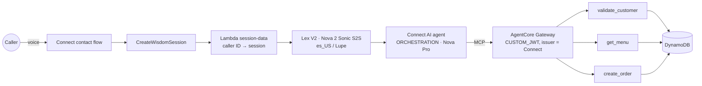

# Connect × Nova Sonic voice agent — 100% CDK, verified by a synthetic phone call

A phone ordering agent for a fictional pizza chain (**Forno Pizza**, Chilean Spanish) built on
**Amazon Connect AI agents**, **Amazon Nova 2 Sonic** speech-to-speech and **MCP tools behind
Amazon Bedrock AgentCore Gateway** — deployed end to end with **one `cdk deploy`** (L1
constructs, no console steps) and verified by a **synthetic caller that places a real audio call**.

> 🇪🇸 Versión en español: [README.es.md](README.es.md)



## Why this repo exists

Most Connect + AgentCore examples still wire the MCP server and the agent's tools in the console.
Today almost all of it is declarable in CloudFormation:

| Piece | Resource |
|---|---|
| MCP gateway + one **Lambda** target per tool | `AWS::BedrockAgentCore::Gateway` / `GatewayTarget` (`Mcp.Lambda`) |
| Inbound JWT minted by Connect, validated on `iss` | `CustomJWTAuthorizer.CustomClaims` |
| Register the gateway as an MCP server in Connect | `AWS::AppIntegrations::Application` (`MCP_SERVER`) + `AWS::Connect::IntegrationAssociation` (`APPLICATION`) |
| Orchestration prompt (YAML, MESSAGES) + agent + tools | `AWS::Wisdom::AIPrompt` / `AIAgent` (`MODEL_CONTEXT_PROTOCOL` tools) / `AIAgentVersion` |
| Tool permissions | `AWS::Connect::SecurityProfile` (`Applications: MCP`) |
| Nova 2 Sonic on the bot | `AWS::Lex::Bot` → `BotLocale.UnifiedSpeechSettings` |
| Contact flow wiring session → bot → agent | `AWS::Connect::ContactFlow` with `Fn::Sub`-injected ARNs |

Two calls still have **no CloudFormation resource** and run as `AwsCustomResource`:
attaching the security profile to the AI agent (`AssociateSecurityProfiles`,
`EntityType=AI_AGENT`) and associating a phone number with a flow.
([Wishlist item](https://builder.aws.com/wishlist/3MLe2KQslzvCmupy5PYFywEQkSU_w/cloudformation-support-to-attach-a-security-profile-to-an-amazon-connect-ai-agent-mcp-tools) — vote if you need it too.)

## The reliability layer: the voice model proposes, the tools decide

A speech-to-speech model hears noise, mishears numbers and is eager to please. Every fact that
matters is therefore validated **server-side**, and every failure comes back as a structured
error the model can act on (`code` + `suggestedAction`):

| Risk | Guard | Where |
|---|---|---|
| Model invents or mishears the customer's number | Caller ID comes from the carrier (`$.CustomerEndpoint.Address`) into the session as `{{$.Custom.customer_phone}}`; the model never dictates it | `src/lambdas/session-data`, flow, prompt |
| Spoken / malformed phone | Normalized to E.164 (`9 1234 5678`, `56912345678`…) or `INVALID_PHONE` | `validate-customer` |
| Pizza not on the menu | `PIZZA_NOT_ON_MENU` **plus the real catalog** so the agent offers a valid alternative | `create-order` |
| "dos", 0, 50 pizzas | Integer 1–10 per line, 1–10 lines or `INVALID_QUANTITY` / `ORDER_TOO_LARGE` | `create-order` |
| Model computes a wrong total | Total computed from DynamoDB prices; the prompt must read back *that* number | `create-order`, prompt |
| Model retries the tool → duplicate order | `orderId = uuid5(contactId + lines)` + conditional put → `status: duplicate` | `create-order` |
| Forged token hits the gateway | `CUSTOM_JWT` bound to the Connect instance issuer → `401` | gateway |

Offline tests for these guards: `python -m unittest discover -s tests/unit -v`.

## Latency: Lambda cold starts on voice turns

A cold tool Lambda adds silence to the call. Measured on the deployed tools (Python 3.12, us-east-1):

| Config | Cold penalty | Warm |
|---|---|---|
| 256 MB (default) | init 0.38–0.50 s + ~0.17 s first DynamoDB call | 10–15 ms |
| 512 / 1024 MB | init 0.48–0.49 s — **no gain** | 8–9 ms |
| SnapStart | restore 0.46 s — **no gain** for small handlers | 19 ms |
| Provisioned concurrency (1) | **none** | 10 ms |

`TOOL_WARM_MODE=provisioned` (plus `TOOL_PROVISIONED_CONCURRENCY`) keeps the three tools and the
`session-data` Lambda warm through a `live` alias. Every consumer (gateway targets, permissions,
contact flow) always invokes that alias, so switching modes never changes a cross-stack ARN.

## Prerequisites

- AWS account, region **us-east-1**, CDK bootstrapped (`npx cdk bootstrap`).
- Amazon Bedrock model access for **Amazon Nova Pro** and **Amazon Nova 2 Sonic**.
- Node.js 20+, Python 3.12+ with `boto3`, AWS CLI v2.
- Cost: Connect instance + per-minute voice, Bedrock tokens, a few Lambdas/tables. A test run
  is cents to a few dollars; **run the teardown when you are done**.

## Deploy → verify → clean up

```bash
cp .env.example .env            # set AWS_ACCOUNT_ID; everything else has defaults
npm ci && npm run build
npm test                        # synth + resource assertions (offline)
npx cdk deploy "Dev/*"          # 8 stacks, ~10 min (Connect instance creation dominates)

python scripts/seed.py          # fixed menu + stores
python scripts/stack_env.py     # shows the resolved instance / assistant / flow / agent ids
```

**Verify with a real audio call** (no phone number needed):

```bash
(cd tools/webrtc-caller && npm ci && npm run build)   # headless Chrome + Chime SDK
python scripts/synthesize-audio.py                    # caller clips (Polly, voice Pedro)
python scripts/call-test.py                           # all cases in tests/calls/cases
```

Each case opens `StartWebRTCContact` into the live flow, answers the bot from its transcript,
then checks the order row in DynamoDB (joined by `contactId`) and the MCP tool calls the agent
actually made (Q in Connect `ListSpans`). Example:

```
▶ happy-path: Caller orders 2 napolitanas + 1 pepperoni and confirms…
  BOT: ¡Hola! Bienvenido a Forno Pizza…
  CALLER: <order-two-napolitana-one-pepperoni>
  ...
  ✔ orders == 1  found 1
  ✔ total == 27970  got 27970
  ✔ tools called ⊇ ['create_order', 'validate_customer']
  PASS
```

**Clean up** (empties buckets, destroys every stack, removes leftovers):

```bash
scripts/teardown.sh
```

Want a real phone number? Set `ENABLE_PHONE_NUMBER=true` (US DID). New accounts often fail with
*"The allowed limit for claimed phone numbers has been exceeded for your instance"* — that is a
Service Quotas limit, not a template bug. Some countries (e.g. Chile +56) need an AWS Support case.

## Repo layout

```
bin/ lib/ config/            CDK app (L1-first; see CLAUDE.md for conventions)
src/lambdas/                 MCP tools + session-data Lambda (Python 3.12, no deps)
prompts/                     orchestration prompt (MESSAGES YAML)
infrastructure/contact-flow/ flow JSON with ${Placeholders}
scripts/                     seed, call-test, observability, teardown (IDs from stack outputs)
tools/webrtc-caller/         headless synthetic caller (Puppeteer + Chime SDK)
tests/                       CDK assertions, tool unit tests, call cases + audio manifest
.claude/skills/              Claude Code skills for UAT, tool-call tracing and voice prompting
docs/                        design notes and remaining manual steps
```

## Lessons learned the hard way

- **Don't put `AllowedAudience=<gateway-id>` on the gateway.** Connect's JWT doesn't carry it;
  the MCP server registers but lists **0 tools**. Validate `iss` with `CustomClaims`.
- **The AI prompt body must be MESSAGES YAML**: a `system:` block plus `messages:` containing
  only `"{{$.conversationHistory}}"`. Plain text fails with *"Prompt is not in expected YAML format"*.
- **Nova Sonic S2S is not available on `es_419`** — use `es_US` (voice `Lupe`), and don't set
  `VoiceSettings` together with `UnifiedSpeechSettings`.
- **Lex `BotVersion` only snapshots DRAFT when created.** This repo hashes the locale config
  into the version description so config changes mint a new version and repoint the alias.
- **Wrap spoken output in `<message>` tags** or the agent stays silent.
- Agent tool ids follow `gateway_<gatewayId>__<target>___<tool>`; the agent must be created
  **after** the MCP_SERVER app association exists.

## License

MIT-0. Fictional brand; no affiliation with any real company.
